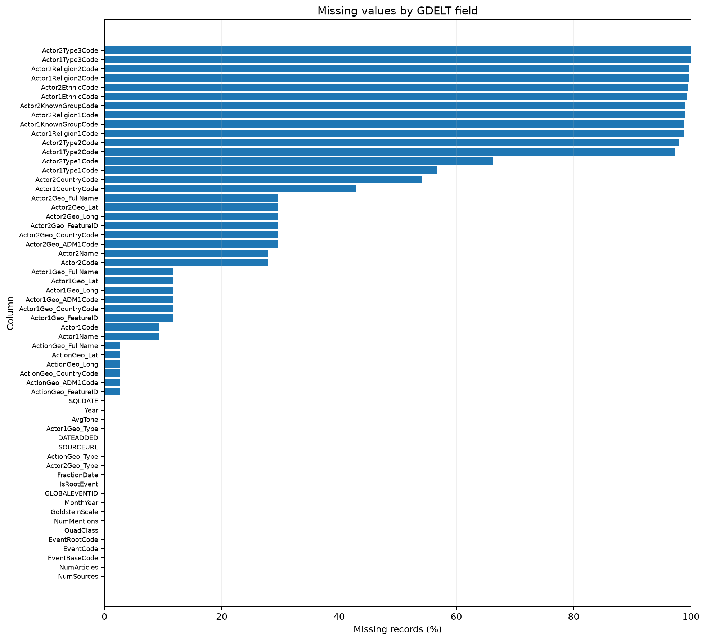
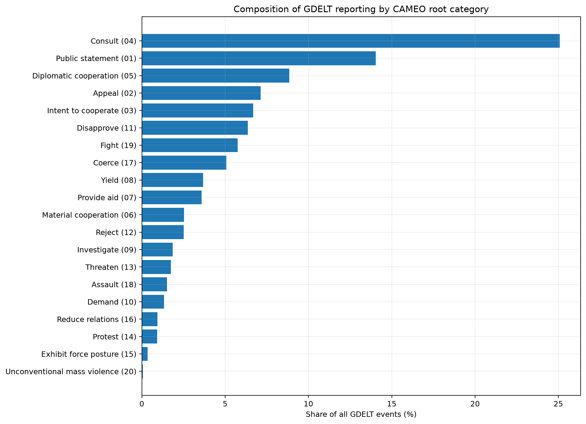
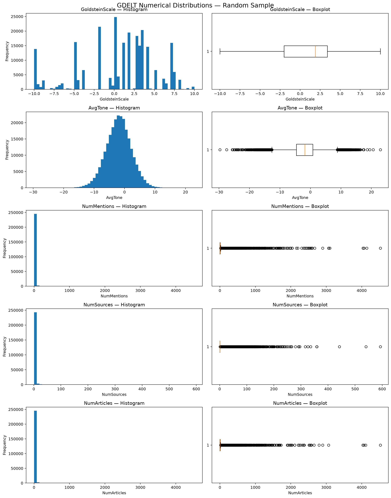
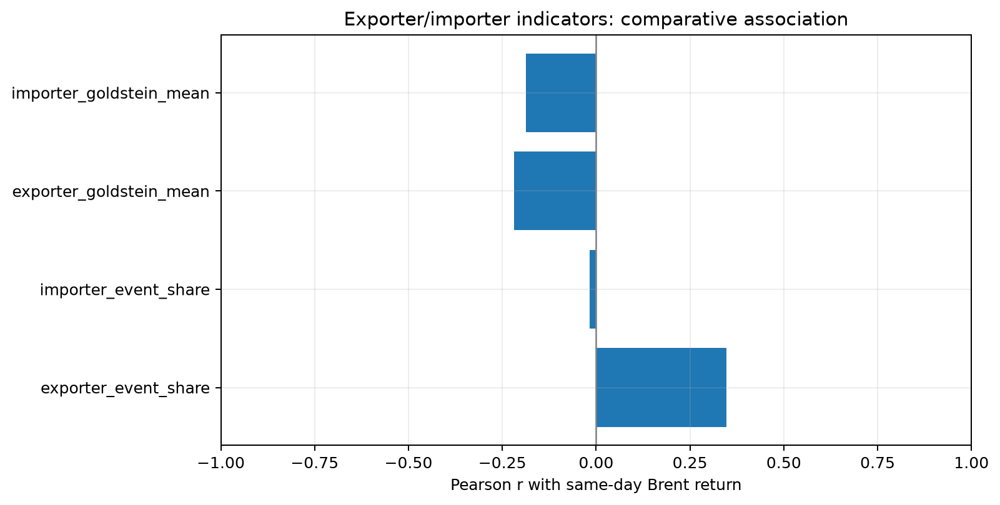
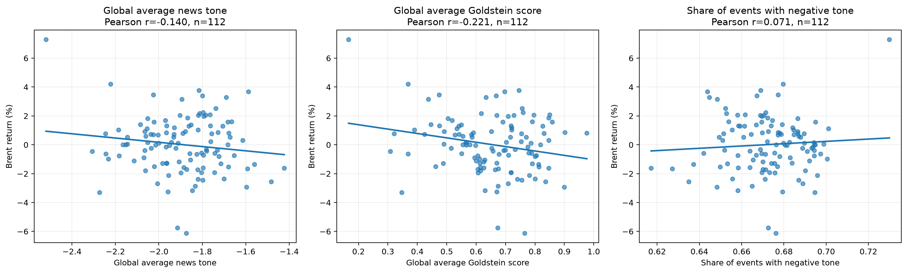

# Geopolitical Reporting and Brent Crude Oil Returns

**Phase 2 — Data Intensive Computing**

**Team:** Data Wizards — Kevin, Dai Trang Vo, and Harish

---

## 1. Executive Summary

We processed GDELT event data from January 1 to June 13, 2025, to investigate whether geopolitical events are related to changes in Brent crude oil prices.

The raw dataset contains **20,343,168 event records**, 58 original columns, and approximately 7.5 GiB of data.

Our main finding was that the countries involved in geopolitical events appeared more informative than the total number of events when examining relationships with Brent crude oil returns.

- **Exporter-related event share:** Pearson r = +0.3465
- **Importer-related event share:** Pearson r = −0.0168
- **Worldwide event count:** Pearson r = −0.1322

Consultations, public statements, and diplomatic cooperation accounted for nearly 48% of records, demonstrating that overall GDELT activity should not be interpreted as conflict intensity.

These findings suggest that future oil-price forecasting models should investigate exporter-related and event-specific indicators rather than relying only on broad news volume.

However, these are same-day associations. They do not establish causation or forecasting ability. In Phase 3, we will investigate lagged geopolitical indicators and test their predictive performance.

---

## 2. Connection to Phase 1

We wanted to investigate whether adding event-based features could improve price predictions compared with using historical prices alone.

In Phase 2, we prepared the data for this analysis by:

- Cleaning and validating geopolitical event records.
- Creating daily geopolitical indicators.
- Integrating these indicators with Brent crude oil prices.
- Examining correlations and relationships between geopolitical activity and Brent returns.

We also changed our target from retail gasoline prices to **Brent crude oil prices**, allowing us to focus on an international crude oil benchmark.

We used **GDELT 1.0 Event records**, covering January 1 to June 13, 2025. This corrects our earlier description of the dataset as GDELT 2.0.

Our exploratory analysis examined event categories, news tone, and events involving major oil exporters and importers.

In Phase 3, we will test whether information from earlier geopolitical events improves future-price predictions compared with historical prices alone.

---

## 3. Data Cleaning and Processing

### 3.1 Data Overview and Profiling Results

We used GDELT 1.0 Event records from January 1 to June 13, 2025.

| Metric | Value |
|---|---:|
| Total records | 20,343,168 |
| Original columns | 58 |
| Daily source files | 164 |
| Raw dataset size | Approximately 7.5 GiB |
| Profiling sample | 250,000 records |

We first examined smaller samples to understand the schema and test processing functions. We then checked the full dataset using chunked reading.

For selected distribution statistics and outlier analysis, we used a fixed-seed random sample of 250,000 records.

#### Main Profiling Findings

| Area | Main findings |
|---|---|
| Missing values | Actor1CountryCode: 42.85%; Actor2CountryCode: 54.14%; ActionGeo_CountryCode: 2.64%; 110 missing Goldstein scores |
| Event classifications | The initial CAMEO reference omitted some valid codes; 16 malformed records remained after investigation |
| Dates | 173,888 records (0.85%) had reporting delays exceeding 30 days |
| Numerical distributions | NumMentions, NumSources, and NumArticles were strongly right-skewed |
| Outliers | NumSources had an IQR of zero in the profiling sample |
| Duplicates | No duplicate or missing GLOBALEVENTID values; multiple events could share one SOURCEURL |

Missing actor-country information also differed across event categories. Therefore, removing every record with missing country information could change the dataset's event composition.

Similarly, unusually high reporting counts could represent important geopolitical events rather than data errors.

### 3.2 Cleaning and Transformation Decisions

Our main approach was to **preserve potentially useful information and flag possible problems rather than automatically delete records**.

We retained the original columns so that transformations could be validated.

| Issue | Cleaning decision and rationale |
|---|---|
| Leading zeros in CAMEO codes | Preserved EventCode, EventBaseCode, and EventRootCode as strings |
| Missing actor-country information | Retained missing values and added quality flags; did not substitute event-location codes |
| Incomplete CAMEO reference | Added verified codes 106 and 1213; retained and flagged 16 malformed records |
| Missing Goldstein scores | Imputed 94 scores for code 1213 using parent code 121 (−4.0); preserved original scores |
| Historical event dates | Retained SQLDATE and DATEADDED; flagged unusually long reporting delays |
| Geographic inconsistencies | Flagged incomplete coordinates and unmatched reference codes |
| Extreme numerical values | Retained plausible outliers without automatic removal or capping |
| Repeated source URLs | Preserved records because one article may describe multiple events |

We created two important Goldstein columns:

- `GoldsteinScale_Adjusted` — the original or imputed Goldstein score.
- `Flag_GoldsteinImputed` — identifies records where the score was imputed.

After adjustment, 16 Goldstein scores remained missing.

We aggregated events by **DATEADDED**, representing when records entered GDELT, rather than relying only on when an event reportedly occurred.

After cleaning, we engineered 83 daily numerical geopolitical indicators covering event counts, CAMEO categories, Goldstein measures, news tone, media attention, and exporter/importer activity.

Missing Brent prices were preserved without forward-filling, backward-filling, or interpolation.

### 3.3 Scalable Processing Strategy

Processing 20 million records required a memory-efficient approach.

We used:

- **Pandas chunking:** 100,000 records per batch.
- **SQLite:** Disk-backed validation of unique event IDs.
- **PyArrow and Parquet:** Compressed storage of cleaned data.
- **Monthly partitioning:** Partitions based on DATEADDED year and month.
- **Batch aggregation:** Daily geopolitical statistics accumulated across cleaned records.

Each processing batch standardized data types, validated values, applied cleaning rules, and created quality flags.

The reusable processing logic was placed in:

- `src/data_cleaning.py` — cleaning and validation functions.
- `src/feature_engineering.py` — geopolitical feature calculations.
- `src/pipeline.py` — chunked processing and pipeline execution.

This separated reusable processing logic from exploratory notebooks.

### 3.4 Processing Outcomes and Runtime

| Output | Final result |
|---|---|
| Cleaned event dataset | 20,343,168 rows × 90 columns |
| Quality flags | 28 |
| Cleaned storage size | Approximately 1.38 GiB |
| Original CSV size | Approximately 7.5 GiB |
| Monthly Parquet partitions | 6 |
| Daily geopolitical dataset | 164 rows × 84 columns |
| Numerical geopolitical indicators | 83 |
| Dataset after Brent integration | 164 rows × 86 columns |
| Available Brent prices | 113 |
| Available Brent returns | 112 |
| Integrated feature-engineering runtime | Approximately 57 seconds |

Validation confirmed that all original records were preserved and that no duplicate or missing event IDs were found.

The final daily geopolitical dataset had no duplicate dates, missing feature values, or infinite numerical values.

The approximately 57-second runtime represents **feature engineering only**, excluding downloading and cleaning.

Full cleaning runtime and peak RAM usage were not recorded.

---

## 4. Exploratory Data Analysis

### 4.1 Approach and Data Completeness

Our EDA progressed from data coverage and event composition to reporting intensity, timing, and relationships with Brent returns.

The project documents approximately 15 profiling investigations and six substantive EDA investigations.

Some figures reconstruct profiling summaries rather than regenerate the analysis directly from cleaned partitions. Strict verification of final processed-data distributions remains a future improvement.

### 4.2 Missingness and Geographic Coverage

Actor-country affiliation was substantially less complete than action-location information.

| Field | Missing values |
|---|---:|
| Actor1CountryCode | 42.85% |
| Actor2CountryCode | 54.14% |
| ActionGeo_CountryCode | 2.64% |

Missingness also varied by event type.

For Actor2CountryCode:

- Consultations: 42.83% missing.
- Investigations: 68.73% missing.
- Aid-related events: 67.78% missing.

Removing all incomplete records could therefore disproportionately exclude certain event categories.

The United States accounted for approximately 32.39% of action-location records.

This reflects **GDELT's reporting distribution**, not necessarily the true geographical distribution of worldwide geopolitical activity.

**Figure 1 — Selected missingness rates**

### 4.3 Event Composition

The most common geopolitical event categories were:

| CAMEO category | Share of all records |
|---|---:|
| Consultations | 25.09% |
| Public statements | 14.04% |
| Diplomatic cooperation | 8.85% |
| **Combined** | **47.98%** |

Nearly half of all records belonged to these three categories.

This demonstrates that **GDELT reporting is not dominated by conflict**.

Verbal cooperation was the largest QuadClass group, and approximately 58.74% of event records had `IsRootEvent = 1`.

We therefore retained all 20 standard CAMEO root categories in feature engineering rather than restricting the dataset to negative events.

**Figure 2 — CAMEO event composition**

### 4.4 Reporting Volume Variation

Daily reporting volumes varied considerably.

| Statistic | Events per day |
|---|---:|
| Minimum | 64,742 |
| Median | 136,635 |
| Maximum | 161,604 |

Reporting volumes were generally lower on weekends.

These variations may reflect media publication cycles in addition to geopolitical activity.

This motivated our use of event shares and plans to investigate day-of-week effects.

### 4.5 Skewness and Robust Statistics

Media-attention variables had strongly right-skewed distributions.

Selected medians from the 250,000-record profiling sample:

| Variable | Median |
|---|---:|
| GoldsteinScale | 1.90 |
| AvgTone | −1.854 |
| NumMentions | 4 |
| NumSources | 1 |
| NumArticles | 4 |

For NumSources, the first and third quartiles were both one, producing an IQR of zero.

Consequently, the usual IQR outlier rule was unsuitable for automatically removing observations.

We retained plausible extremes and considered:

- `log1p` for nonnegative, right-skewed reporting counts.
- `asinh` for signed Goldstein impact indices.

**Figure 3 — Numerical distributions**

### 4.6 Event Dates and Reporting Delays

Approximately 97.52% of records had matching SQLDATE and DATEADDED values.

The remaining 2.48% represented events recorded after their reported occurrence date.

This matters for forecasting because historical event dates may precede the time information became available.

We selected DATEADDED for daily aggregation to reduce the risk of using information before it entered GDELT.

This does not fully establish the original news publication time.

---

## 5. First Analytics Results

We examined relationships between daily geopolitical features and Brent crude oil returns from January 1 to June 13, 2025.

The analysis used **112 available Brent return observations**.

Returns were calculated from consecutive observed Brent prices. Consequently, a return following a weekend or holiday could cover multiple calendar days.

### 5.1 Correlation Results

**Table 1 — Same-day Pearson correlations with Brent returns**

| Geopolitical indicator | Pearson r | p-value |
|---|---:|---:|
| Exporter event share | **+0.3465** | **0.0002** |
| Importer event share | −0.0168 | 0.8604 |
| Mean Goldstein | −0.2213 | 0.0190 |
| Mean news tone | −0.1400 | 0.1410 |
| Negative-tone share | +0.0708 | 0.4581 |
| Worldwide event count | −0.1322 | 0.1647 |

These correlations describe same-day associations, not causal effects or validated forecasting performance.

### 5.2 Worldwide Activity vs. Exporter Activity

Worldwide event counts showed a weak negative relationship with Brent returns:

**r = −0.1322**

By comparison, exporter-related event share showed a more noticeable positive association:

**r = +0.3465**

Importer event share showed almost no linear relationship:

**r = −0.0168**

The findings suggest that the countries involved in geopolitical reporting may matter more than worldwide event volume alone.

However, an event may involve both exporting and importing countries, so the groups are not necessarily mutually exclusive.

**Figure 4 — Exporter and importer correlation comparison**

### 5.3 Goldstein Scores and News Tone

Mean Goldstein scores had a negative correlation with Brent returns:

**r = −0.2213**

This means lower Goldstein scores tended to coincide with higher Brent returns within the observed sample.

One possible explanation is that geopolitical conflict or instability may raise concerns about oil supply.

However, this is an interpretation rather than evidence of causation.

The Goldstein Spearman correlation was weaker:

**ρ = −0.1191, p = 0.2110**

This suggests that the Pearson association could be influenced by unusual observations.

Mean news tone had a weaker negative association:

**r = −0.1400**

Negative-tone event share showed almost no association:

**r = +0.0708**

Goldstein scores and news tone measure different aspects of geopolitical information:

- **GoldsteinScale:** The cooperation or conflict intensity associated with an event classification.
- **AvgTone:** The positive or negative language associated with the reporting.

**Figure 5 — Goldstein, news tone, and Brent returns**

### 5.4 Country-Specific and Internal Activity

Country-specific relationships were generally weak.

| Indicator | Pearson r |
|---|---:|
| Iran Goldstein | −0.1041 |
| Russia Goldstein | −0.1302 |
| Exporter internal-event share | +0.0906 |

Internal events were operationally defined as records where Actor1 and Actor2 had the same nonmissing country code.

These results indicate that focusing on individual countries or internal activity did not automatically produce stronger same-day associations.

One limitation is that the indicators include many events unrelated to oil production, supply, or trade.

### 5.5 Interpretation and Limitations

The exporter event-share relationship is the most promising exploratory finding.

However, several limitations prevent predictive conclusions:

1. **Limited sample:** Only 112 available return observations across approximately six months.
2. **Timing:** Same-day GDELT reporting may not have been available before the corresponding Brent price observation.
3. **Market calendar:** Returns following nontrading days may cover several calendar days.
4. **Missing country information:** Incomplete actor-country fields may affect exporter/importer classification.
5. **Confounding factors:** Other economic and market developments may explain observed relationships.
6. **Statistical robustness:** Outliers, multiple comparisons, and time-series dependence require further investigation.

SQLDATE represents the reported event date, while DATEADDED represents when the event entered GDELT.

Neither necessarily provides the precise original news publication timestamp needed for rigorous information-time alignment.

The correlations in this section should therefore be interpreted as exploratory associations rather than forecasting evidence.

---

## 6. Dead Ends and Lessons Learned

### 6.1 Country-Code Mismatch

Our initial exporter/importer classifications used two-letter country codes.

However, the relevant GDELT actor-country fields used three-letter codes such as USA, IRN, and RUS.

We corrected the mappings before full feature processing.

**Lesson:** Validate reference codes against actual dataset conventions rather than assuming common coding standards.

### 6.2 IQR Outlier Detection

NumSources had an IQR of zero in the profiling sample.

Automatically removing observations flagged by this method would have excluded many potentially valid records.

We preserved these values and used robust statistical summaries.

**Lesson:** An unusual numerical observation is not necessarily an erroneous record.

### 6.3 Weak Worldwide and Country-Specific Relationships

Worldwide event counts and Iran/Russia Goldstein indicators showed weak same-day relationships with Brent returns.

These results motivated further investigation of event composition and exporter/importer distinctions.

**Lesson:** Increasing the number of indicators does not guarantee stronger predictive information.

---

## 7. Important Design Decisions

| Decision | Alternative considered | Rationale and trade-off |
|---|---|---|
| Chunked Pandas + SQLite | Loading all records into RAM | Memory-bounded processing; some global operations require additional passes |
| Preserve records with flags | Delete incomplete or extreme records | Reduces category-dependent deletion, but downstream analyses must consider quality flags |
| DATEADDED aggregation | SQLDATE alone | Closer to information-entry time; still requires market-time alignment |
| Monthly Parquet partitions | Repeated full CSV loading | Lower storage requirements and selective reading |
| Historical exporter/importer groups | Reclassification using 2025 trade data | Supports methodological comparison but may not fully reflect current trade roles |
| Brent without price filling | WTI or synthetic daily prices | Preserves observed Brent data and market-calendar gaps |
| Selected Goldstein imputation | Deleting or globally imputing scores | Uses a documented parent-code approximation while preserving original values |

---

## 8. Reproducibility Statement

We tested the cleaning pipeline on 100,000 records and verified the full cleaned dataset against the original row count of 20,343,168.

Feature engineering was also rerun on all six monthly partitions and reproduced the daily geopolitical dataset containing:

- 164 rows.
- 84 columns.
- 83 numerical geopolitical indicators.
- No duplicate reporting dates.

The reusable processing implementation is located in:

- `src/data_cleaning.py`
- `src/feature_engineering.py`
- `src/pipeline.py`

The cleaned event data was stored in monthly Parquet partitions, allowing repeated analysis without rereading the raw combined CSV.

The final small daily analytical datasets are included in the repository under `data/processed/`.

These tests were completed in our existing development environment.

**Independent reproduction in a fresh environment has not yet been verified.** The repository also excludes some large raw and intermediate datasets.

The current code should therefore be considered an academic research implementation with documented outputs, rather than a fully verified one-command reproducible pipeline.

---

## 9. Phase 3 — Next Steps

Phase 3 will focus on moving from exploratory associations toward forecasting evaluation.

Planned work includes:

1. **Lagged geopolitical features:** Examine relationships using events from earlier dates, including two-day and seven-day lags.
2. **Exporter-specific event categories:** Identify which geopolitical event types contribute to the exporter association.
3. **Longer observation periods:** Extend the analysis toward five years of data.
4. **Robustness checks:** Investigate influential observations, reporting cycles, and variation across periods.
5. **Forecasting models:** Compare models using historical Brent prices alone against models incorporating geopolitical indicators.
6. **Chronological validation:** Evaluate forecasting accuracy using time-ordered training and testing.
7. **Timing alignment:** Ensure the geopolitical information used in forecasts was available before the prediction point.

The main objective is to determine whether geopolitical indicators provide **out-of-sample predictive value** beyond historical Brent price information.

---

## 10. References

1. **The GDELT Project.** *GDELT Data Format Codebook*, Version 1.03, August 25, 2013.  
   https://gdeltproject.org/data.html

2. **U.S. Energy Information Administration / Federal Reserve Bank of St. Louis.** *Crude Oil Prices: Brent — Europe*, FRED Series DCOILBRENTEU.  
   https://fred.stlouisfed.org/series/DCOILBRENTEU

3. **Vodenska et al. (2016).** *Impact of Global Events on Crude Oil Prices*. Methodological reference used for exporter/importer relationships and geopolitical indicators. Full bibliographic details to be verified.

4. **Elshendy, M., Fronzetti Colladon, A., Battistoni, E., and Gloor, P. A. (2018).** "Using Four Different Online Media Sources to Forecast the Crude Oil Price." *Journal of Information Science*, 44(3), 408–421.  
   https://doi.org/10.1177/0165551517698298

5. **Tukey, J. W. (1977).** *Exploratory Data Analysis*. Addison-Wesley.

